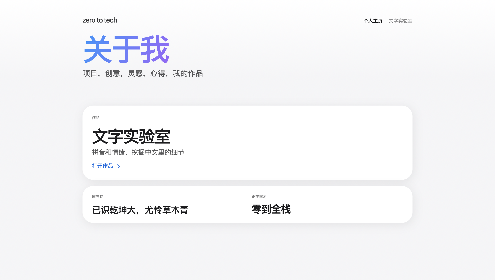

# Text Lab · zero to tech

English | [简体中文](./README.zh-CN.md)

A small full-stack web app for analysing Chinese text. Paste in a passage and get tonal pinyin and a sentiment score back, with every analysis saved to a history log. The project includes a personal homepage and the "Text Lab" tool, and is the first complete project I built while learning full-stack development.

**Live demo:** [http://textlab-lily.australiaeast.cloudapp.azure.com](http://textlab-lily.australiaeast.cloudapp.azure.com) *(hosted on Azure; may occasionally be offline)*

> Please do not enter personal or sensitive information. Analysis history is stored on the server.



*Text Lab: input on the left, pinyin and sentiment result on the right.*

## Features

- **Pinyin conversion:** converts Chinese text into pinyin with tone marks
- **Sentiment analysis:** returns a score from 0 to 1 and a label (Positive at ≥ 0.6, Negative at ≤ 0.4, otherwise Neutral)
- **History:** each result is saved to a database with a timestamp and can be viewed later
- **Personal homepage:** shows my featured work, motto and current learning focus, with content served by the backend API

### Example

| Input | Pinyin | Score | Label |
|---|---|---|---|
| 今天的风很轻，适合把脑海里的想法慢慢写下来。 | jīn tiān de fēng hěn qīng ... | 0.86 | Positive |

## Tech Stack

| Layer | Technologies |
|---|---|
| Frontend | Next.js, React, TypeScript, CSS |
| Backend | Python, FastAPI, Pydantic, Uvicorn |
| Text processing | pypinyin (pinyin), SnowNLP (sentiment analysis) |
| Storage | SQLite |
| Hosting | Microsoft Azure (virtual machine) |
| Tools | Git, GitHub, VS Code |

## API

| Method | Endpoint | Description |
|---|---|---|
| POST | `/api/analyze` | Accepts `{ "text": "..." }` and returns pinyin, sentiment score, label and timestamp |
| GET | `/api/history` | Returns past analysis records |
| GET | `/api/profile` | Returns homepage content |

## Getting Started

To run the project locally:

```bash
# 1. Start the backend (http://localhost:8000 by default)
cd backend
pip install -r requirements.txt
uvicorn main:app --reload

# 2. Start the frontend (in a new terminal, from the project root)
npm install
npm run dev        # open http://localhost:3000
```

The CORS allow-list is set in `backend/main.py`. It currently allows `http://localhost:3000` for local development; add your deployed frontend URL there if you host the app elsewhere.

## Deployment

The app is deployed on a Microsoft Azure virtual machine in Australia East, with a static public IP and an Azure DNS name label (`textlab-lily.australiaeast.cloudapp.azure.com`).

## Project Structure

```
app/          Next.js pages and routes
components/   Reusable UI components
css/          Styles
backend/
  main.py     FastAPI entry point and endpoints
  storage.py  Database read/write
docs/         Screenshots used in this README
```

## Known Limitations and Next Steps

- SnowNLP was trained on e-commerce reviews, so results can be less accurate on literary or conversational text. I plan to try a stronger model or an LLM API.
- The demo currently runs over HTTP; next step is adding HTTPS (for example with Caddy or Let's Encrypt).
- History is shared between all visitors; I plan to separate it per user.
- Add input validation (empty or overly long text) and unit tests.

## Author

lilygu8 · [lilygu4@gmail.com]