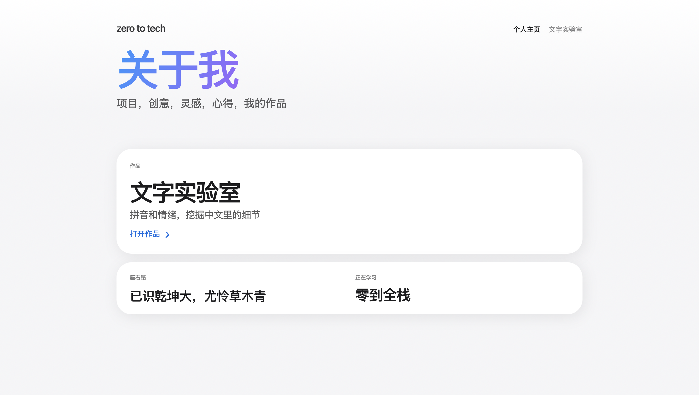

# 文字实验室 · zero to tech

[English](./README.md) | 简体中文

一个中文文本分析的全栈小项目：输入一段中文，返回带声调的拼音和情感倾向，并保存分析历史。包含个人主页和"文字实验室"两个页面，是我"零到全栈"学习路上的第一个完整项目。

**在线体验：** [http://textlab-lily.australiaeast.cloudapp.azure.com](http://textlab-lily.australiaeast.cloudapp.azure.com) *（部署在 Azure，可能偶尔离线）*

> 请不要输入个人或敏感信息，分析历史会保存在服务器上。



*文字实验室：左侧输入，右侧显示拼音和情感结果。*

## 功能

- **拼音转换**：把中文转成带声调的拼音
- **情感分析**：输出 0~1 的情感分数，并给出"偏积极 / 中性 / 偏消极"判断（≥ 0.6 偏积极，≤ 0.4 偏消极）
- **历史记录**：每次分析结果连同时间一起存入数据库，可随时查看
- **个人主页**：展示作品、座右铭和学习方向，内容由后端接口提供

### 示例

| 输入 | 拼音 | 分数 | 判断 |
|---|---|---|---|
| 今天的风很轻，适合把脑海里的想法慢慢写下来。 | jīn tiān de fēng hěn qīng ... | 0.86 | 偏积极 |

## 技术栈

| 层 | 技术 |
|---|---|
| 前端 | Next.js、React、TypeScript、CSS |
| 后端 | Python、FastAPI、Pydantic、Uvicorn |
| 文本处理 | pypinyin（拼音）、SnowNLP（情感分析） |
| 存储 | SQLite |
| 部署 | Microsoft Azure（虚拟机） |
| 工具 | Git / GitHub、VS Code |

## 接口

| 方法 | 路径 | 说明 |
|---|---|---|
| POST | `/api/analyze` | 提交 `{ "text": "..." }`，返回拼音、情感分数、判断和时间 |
| GET | `/api/history` | 获取历史分析记录 |
| GET | `/api/profile` | 获取个人主页内容 |

## 本地运行

```bash
# 1. 启动后端（默认 http://localhost:8000）
cd backend
pip install -r requirements.txt
uvicorn main:app --reload

# 2. 启动前端（新开一个终端，回到项目根目录）
npm install
npm run dev        # 访问 http://localhost:3000
```

CORS 白名单在 `backend/main.py` 中设置，目前允许 `http://localhost:3000` 用于本地开发。如果把前端部署到其他地址，需要把该地址加进白名单。

## 部署

项目部署在澳大利亚东部（Australia East）的 Microsoft Azure 虚拟机上，使用静态公网 IP 和 Azure DNS 名称（`textlab-lily.australiaeast.cloudapp.azure.com`）。

## 项目结构

```
app/          Next.js 页面与路由
components/   可复用组件
css/          样式
backend/
  main.py     FastAPI 入口与接口
  storage.py  数据库读写
docs/         README 使用的截图
```

## 已知限制与后续计划

- SnowNLP 基于电商评论语料训练，对文学化或口语化文本的判断可能不准，后续考虑换成更强的模型或接入大模型 API
- 目前 demo 使用 HTTP，下一步加上 HTTPS（例如 Caddy 或 Let's Encrypt）
- 历史记录目前对所有访问者共享，计划改为按用户隔离
- 补充输入校验（如空文本、超长文本）和单元测试

## 作者

lilygu8 · 【lilygu4@gmail.com】